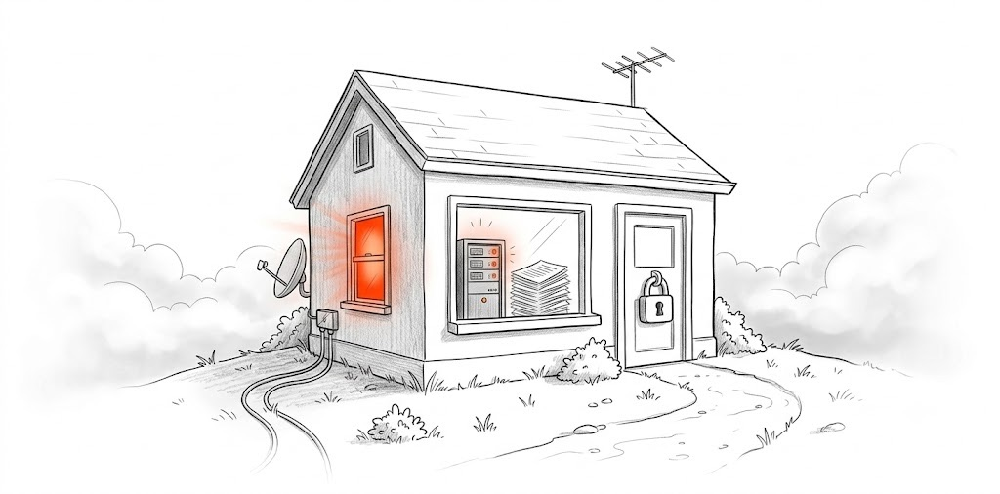

<section class="hero">

docs/v0.1.1<h1>See which visits turned into payments.</h1>
Virling ties every visit to the payment that followed. Run one binary on your own server, add a script under 1 KB and connect a read-only payment key.

<a class="btn" href="quickstart.html"><svg width="16" height="16" viewBox="0 0 24 24" fill="none" stroke="currentColor" stroke-width="2" stroke-linecap="round" stroke-linejoin="round" aria-hidden="true"><path d="M13 2L4 14h7l-1 8 9-12h-7z"/></svg>Quickstart</a><a class="btn light" href="https://github.com/virling/virling"><svg width="18" height="18" viewBox="0 0 24 24" aria-hidden="true"><path fill="currentColor" d="M12 .297c-6.63 0-12 5.373-12 12 0 5.303 3.438 9.8 8.205 11.385.6.113.82-.258.82-.577 0-.285-.01-1.04-.015-2.04-3.338.724-4.042-1.61-4.042-1.61C4.422 18.07 3.633 17.7 3.633 17.7c-1.087-.744.084-.729.084-.729 1.205.084 1.838 1.236 1.838 1.236 1.07 1.835 2.809 1.305 3.495.998.108-.776.417-1.305.76-1.605-2.665-.3-5.466-1.332-5.466-5.93 0-1.31.465-2.38 1.235-3.22-.135-.303-.54-1.523.105-3.176 0 0 1.005-.322 3.3 1.23.96-.267 1.98-.399 3-.405 1.02.006 2.04.138 3 .405 2.28-1.552 3.285-1.23 3.285-1.23.645 1.653.24 2.873.12 3.176.765.84 1.23 1.91 1.23 3.22 0 4.61-2.805 5.625-5.475 5.92.42.36.81 1.096.81 2.22 0 1.606-.015 2.896-.015 3.286 0 .315.21.69.825.57C20.565 22.092 24 17.592 24 12.297c0-6.627-5.373-12-12-12"/></svg>View on GitHub</a>

<b>Quickstart</b><a href="quickstart.html">Full guide<svg width="14" height="14" viewBox="0 0 24 24" fill="none" stroke="currentColor" stroke-width="2" stroke-linecap="round" stroke-linejoin="round" aria-hidden="true"><path d="M5 12h14M13 6l6 6-6 6"/></svg></a>

1

Start the server

<pre><code class="language-sh">docker run -d --name virling -p 8080:8080 \
  -v virling-data:/data \
  ghcr.io/virling/virling:latest serve --app</code></pre>

2

Add your site

<pre><code class="language-sh">docker exec virling virling add-site \
  yourdomain.com --owner you@example.com</code></pre>

3

Paste the script before &lt;/head&gt;

<pre><code class="language-html">&lt;script defer src="https://YOUR-HOST/v.js"
  data-site="yourdomain.com"&gt;&lt;/script&gt;</code></pre>

</section>
<section class="wrap sec">

<h2>Guides</h2>
Everything Virling does today, in the order you set it up.

<svg width="18" height="18" viewBox="0 0 24 24" fill="none" stroke="currentColor" stroke-width="1.9" stroke-linecap="round" stroke-linejoin="round" aria-hidden="true"><path d="M13 2L4 14h7l-1 8 9-12h-7z"/></svg><h3><a href="quickstart.html">Quickstart</a></h3>
From an empty server to your first attributed payment in six steps.
<ul><li><a href="quickstart.html#start-the-server">Start the server<svg width="14" height="14" viewBox="0 0 24 24" fill="none" stroke="currentColor" stroke-width="2" stroke-linecap="round" stroke-linejoin="round" aria-hidden="true"><path d="M9 6l6 6-6 6"/></svg></a></li><li><a href="quickstart.html#add-the-script">Add the script<svg width="14" height="14" viewBox="0 0 24 24" fill="none" stroke="currentColor" stroke-width="2" stroke-linecap="round" stroke-linejoin="round" aria-hidden="true"><path d="M9 6l6 6-6 6"/></svg></a></li><li><a href="quickstart.html#link-checkout-to-visits">Link checkout<svg width="14" height="14" viewBox="0 0 24 24" fill="none" stroke="currentColor" stroke-width="2" stroke-linecap="round" stroke-linejoin="round" aria-hidden="true"><path d="M9 6l6 6-6 6"/></svg></a></li></ul>

<svg width="18" height="18" viewBox="0 0 24 24" fill="none" stroke="currentColor" stroke-width="1.9" stroke-linecap="round" stroke-linejoin="round" aria-hidden="true"><path d="M12 3v12M7 10l5 5 5-5M4 20h16"/></svg><h3><a href="install/index.html">Install</a></h3>
The Docker image, release binaries for Linux and macOS, or a build from source.
<ul><li><a href="install/docker.html">Docker<svg width="14" height="14" viewBox="0 0 24 24" fill="none" stroke="currentColor" stroke-width="2" stroke-linecap="round" stroke-linejoin="round" aria-hidden="true"><path d="M9 6l6 6-6 6"/></svg></a></li><li><a href="install/binary.html">Binary<svg width="14" height="14" viewBox="0 0 24 24" fill="none" stroke="currentColor" stroke-width="2" stroke-linecap="round" stroke-linejoin="round" aria-hidden="true"><path d="M9 6l6 6-6 6"/></svg></a></li><li><a href="install/source.html">Build from source<svg width="14" height="14" viewBox="0 0 24 24" fill="none" stroke="currentColor" stroke-width="2" stroke-linecap="round" stroke-linejoin="round" aria-hidden="true"><path d="M9 6l6 6-6 6"/></svg></a></li></ul>

<svg width="18" height="18" viewBox="0 0 24 24" fill="none" stroke="currentColor" stroke-width="1.9" stroke-linecap="round" stroke-linejoin="round" aria-hidden="true"><path d="M8 6l-6 6 6 6M16 6l6 6-6 6"/></svg><h3><a href="track/script.html">Add the script</a></h3>
One tag, under 1 KB. Pageviews, UTM tags, referrers, route changes and goals.
<ul><li><a href="track/frameworks.html">Framework guides<svg width="14" height="14" viewBox="0 0 24 24" fill="none" stroke="currentColor" stroke-width="2" stroke-linecap="round" stroke-linejoin="round" aria-hidden="true"><path d="M9 6l6 6-6 6"/></svg></a></li><li><a href="track/goals.html">Goals<svg width="14" height="14" viewBox="0 0 24 24" fill="none" stroke="currentColor" stroke-width="2" stroke-linecap="round" stroke-linejoin="round" aria-hidden="true"><path d="M9 6l6 6-6 6"/></svg></a></li><li><a href="track/cookieless.html">Cookieless mode<svg width="14" height="14" viewBox="0 0 24 24" fill="none" stroke="currentColor" stroke-width="2" stroke-linecap="round" stroke-linejoin="round" aria-hidden="true"><path d="M9 6l6 6-6 6"/></svg></a></li></ul>

<svg width="18" height="18" viewBox="0 0 24 24" fill="none" stroke="currentColor" stroke-width="1.9" stroke-linecap="round" stroke-linejoin="round" aria-hidden="true"><rect x="2" y="5" width="20" height="14" rx="2"/><path d="M2 10h20M6 15h4"/></svg><h3><a href="payments/index.html">Connect payments</a></h3>
Read-only keys. The last 90 days are imported, then synced every minute.

<svg viewBox="0 0 24 24" aria-hidden="true"><path fill="#635BFF" d="M13.976 9.15c-2.172-.806-3.356-1.426-3.356-2.409 0-.831.683-1.305 1.901-1.305 2.227 0 4.515.858 6.09 1.631l.89-5.494C18.252.975 15.697 0 12.165 0 9.667 0 7.589.654 6.104 1.872 4.56 3.147 3.757 4.992 3.757 7.218c0 4.039 2.467 5.76 6.476 7.219 2.585.92 3.445 1.574 3.445 2.583 0 .98-.84 1.545-2.354 1.545-1.875 0-4.965-.921-6.99-2.109l-.9 5.555C5.175 22.99 8.385 24 11.714 24c2.641 0 4.843-.624 6.328-1.813 1.664-1.305 2.525-3.236 2.525-5.732 0-4.128-2.524-5.851-6.594-7.305h.003z"/></svg>Stripe<svg viewBox="0 0 30 30" fill="none" aria-hidden="true"><rect x="0.3" y="0.3" width="29.4" height="29.4" rx="14.7" fill="#C6FE1E"/><rect x="0.3" y="0.3" width="29.4" height="29.4" rx="14.7" stroke="#B3E910" stroke-width="0.6"/><mask id="mask0_845_82475" style="mask-type:luminance" maskUnits="userSpaceOnUse" x="5" y="8" width="20" height="15"><path d="M24.0038 8H5.99805V23H24.0038V8Z" fill="white"/></mask><g mask="url(#mask0_845_82475)"><path d="M12.9679 11.4606H12.9599C12.4637 11.3182 11.9387 11.603 11.7707 12.0734C11.585 12.579 11.8795 13.1582 12.3997 13.3182C13.6737 13.6798 14.2211 11.8542 12.9679 11.4606Z" fill="#00160D"/><path d="M23.8265 14.0425C22.1859 10.4505 16.9523 11.9369 16.4689 10.9961C15.0525 8.77368 12.4084 7.52568 9.54993 8.16888C9.10979 7.99288 7.59411 7.94488 6.6146 8.56088L7.20518 8.82168C7.25 8.84088 7.23719 8.83608 7.30281 8.86008C7.5701 8.96088 7.52368 8.93208 7.33162 9.03768C6.89148 9.29528 6.34251 9.59448 6 10.0441C6.0144 10.0649 6.75384 10.2425 6.75384 10.2425C6.76664 10.2457 6.90429 10.2601 6.87388 10.3209C4.45551 14.1385 8.5336 19.9001 10.5134 23.0009H16.2449C15.3598 21.4169 14.3483 19.2553 14.694 17.7881C14.7564 17.5225 14.8364 17.1849 15.1629 17.1401C15.952 17.0137 17.0083 17.0249 17.7605 16.9401C17.7605 16.9401 17.7643 16.9401 17.7717 16.9401C17.9318 16.9321 21.8498 16.4345 22.7877 18.8761C22.8678 19.1001 23.0518 18.9545 23.1254 18.8073C23.8249 17.4169 24.2762 15.2281 23.8297 14.0441L23.8265 14.0425ZM17.5013 12.8633C17.226 13.3545 17.0387 13.9929 16.9907 14.5497C16.9651 14.9033 17.0019 15.2521 17.0371 15.6057C17.0563 15.8009 17.0579 16.0473 16.9011 16.1753C16.765 16.2905 16.5393 16.3017 16.3121 16.3177C15.1965 16.3129 12.4757 16.3177 11.4273 15.6041L11.4209 15.5993C9.89564 14.6697 9.07938 12.5705 9.98527 10.9401C10.2782 10.3865 10.8175 10.0265 11.4321 9.89048C12.2228 9.70968 13.0935 9.84408 13.7993 10.2137C14.0874 10.3593 14.4315 10.5513 14.694 10.7721C15.2141 11.2265 15.6591 11.6985 16.3409 11.8441C16.6546 11.9337 16.9811 11.9209 17.2948 11.9849C17.8822 12.1257 17.7349 12.4601 17.4997 12.8601L17.5013 12.8633Z" fill="#00160D"/></g></svg>Dodo Payments<svg viewBox="0 0 1510 1510" fill="none" aria-hidden="true"><mask id="mask0_545_3" style="mask-type:alpha" maskUnits="userSpaceOnUse" x="0" y="0" width="1510" height="1510"><circle cx="755" cy="755" r="755" transform="matrix(-1 0 0 1 1510 0)" fill="white"/></mask><g mask="url(#mask0_545_3)"><path d="M679.51 -81.6641V571.332L232.436 124.258L123.483 233.21L570.558 680.285H-449.15V834.366H570.515L159.337 1245.55L268.291 1354.5L679.51 943.277V1553.91H833.592V-81.6641H679.51Z" fill="currentColor"/><path d="M1189.51 757.326C1189.51 550.283 1290.75 361.31 1444.36 246.645L1342.97 110.824C1147.75 256.556 1020.02 495.271 1020.02 757.326C1020.02 985.231 1118.44 1184.81 1268.48 1329L1370.05 1432.88L1491.24 1314.39L1387.8 1208.6L1386.79 1207.63C1265.9 1091.86 1189.51 934.764 1189.51 757.326Z" fill="currentColor"/></g></svg>Polar<svg viewBox="0 0 24 24" aria-hidden="true"><path fill="#FFC233" d="m7.4916 10.835 2.3748-6.5114a3.1497 3.1497 0 0 0-.065-2.3418C9.0315.183 6.9427-.398 5.2928.265 3.643.929 2.71 2.4348 3.512 4.3046l2.8197 6.5615c.219.509.97.489 1.16-.03m1.6798 1.0969 6.5334-2.7758c2.1699-.9219 2.7218-3.6907 1.022-5.2905l-.068-.063c-1.6669-1.5469-4.4217-1.002-5.3706 1.0359L8.3566 11.135c-.234.503.295 1.0199.8159.7979m.373.87 6.6454-2.5119c2.2078-.8349 4.6206.745 4.5886 3.0398l-.002.09c-.048 2.2358-2.3938 3.7376-4.5536 2.9467l-6.6724-2.4418a.595.595 0 0 1-.006-1.1229m-.386 1.9269 6.4375 2.9767a3.2997 3.2997 0 0 1 1.6658 1.6989c.769 1.7998-.283 3.6396-1.9328 4.3016-1.6499.662-3.4097.235-4.2097-1.6359l-2.8027-6.5694c-.217-.509.328-1.009.8419-.772"/></svg>LemonSqueezy
<ul><li><a href="payments/index.html#which-key-to-create">Which key to create<svg width="14" height="14" viewBox="0 0 24 24" fill="none" stroke="currentColor" stroke-width="2" stroke-linecap="round" stroke-linejoin="round" aria-hidden="true"><path d="M9 6l6 6-6 6"/></svg></a></li><li><a href="payments/index.html#what-virling-reads">What Virling reads<svg width="14" height="14" viewBox="0 0 24 24" fill="none" stroke="currentColor" stroke-width="2" stroke-linecap="round" stroke-linejoin="round" aria-hidden="true"><path d="M9 6l6 6-6 6"/></svg></a></li></ul>

<svg width="18" height="18" viewBox="0 0 24 24" fill="none" stroke="currentColor" stroke-width="1.9" stroke-linecap="round" stroke-linejoin="round" aria-hidden="true"><path d="M10 14a4 4 0 0 0 5.7 0l3-3a4 4 0 0 0-5.7-5.7l-1 1"/><path d="M14 10a4 4 0 0 0-5.7 0l-3 3a4 4 0 0 0 5.7 5.7l1-1"/></svg><h3><a href="payments/checkout.html">Checkout attribution</a></h3>
Pass the <code>virling_vid</code> visitor ID into checkout so payments match visits.
<ul><li><a href="payments/checkout.html#stripe">Stripe Checkout<svg width="14" height="14" viewBox="0 0 24 24" fill="none" stroke="currentColor" stroke-width="2" stroke-linecap="round" stroke-linejoin="round" aria-hidden="true"><path d="M9 6l6 6-6 6"/></svg></a></li><li><a href="payments/checkout.html#payment-links">Payment links<svg width="14" height="14" viewBox="0 0 24 24" fill="none" stroke="currentColor" stroke-width="2" stroke-linecap="round" stroke-linejoin="round" aria-hidden="true"><path d="M9 6l6 6-6 6"/></svg></a></li><li><a href="payments/checkout.html#dodo-payments">Dodo, Polar, LemonSqueezy<svg width="14" height="14" viewBox="0 0 24 24" fill="none" stroke="currentColor" stroke-width="2" stroke-linecap="round" stroke-linejoin="round" aria-hidden="true"><path d="M9 6l6 6-6 6"/></svg></a></li></ul>

<svg width="18" height="18" viewBox="0 0 24 24" fill="none" stroke="currentColor" stroke-width="1.9" stroke-linecap="round" stroke-linejoin="round" aria-hidden="true"><circle cx="6" cy="5" r="2"/><circle cx="18" cy="19" r="2"/><path d="M8 5h7a3.5 3.5 0 0 1 0 7H9a3.5 3.5 0 0 0 0 7h7"/></svg><h3><a href="attribution/index.html">How attribution works</a></h3>
Sessions, channels, which visit gets the credit, and renewals.
<ul><li><a href="attribution/channels.html">Channels<svg width="14" height="14" viewBox="0 0 24 24" fill="none" stroke="currentColor" stroke-width="2" stroke-linecap="round" stroke-linejoin="round" aria-hidden="true"><path d="M9 6l6 6-6 6"/></svg></a></li><li><a href="attribution/model.html">Model and lookback window<svg width="14" height="14" viewBox="0 0 24 24" fill="none" stroke="currentColor" stroke-width="2" stroke-linecap="round" stroke-linejoin="round" aria-hidden="true"><path d="M9 6l6 6-6 6"/></svg></a></li><li><a href="attribution/unattributed.html">Unattributed revenue<svg width="14" height="14" viewBox="0 0 24 24" fill="none" stroke="currentColor" stroke-width="2" stroke-linecap="round" stroke-linejoin="round" aria-hidden="true"><path d="M9 6l6 6-6 6"/></svg></a></li></ul>

<svg width="18" height="18" viewBox="0 0 24 24" fill="none" stroke="currentColor" stroke-width="1.9" stroke-linecap="round" stroke-linejoin="round" aria-hidden="true"><path d="M4 6h9M17 6h3M4 12h3M11 12h9M4 18h11M19 18h1"/><circle cx="15" cy="6" r="2"/><circle cx="9" cy="12" r="2"/><circle cx="17" cy="18" r="2"/></svg><h3><a href="reference/env.html">Configuration</a></h3>
Every server flag and VIRLING_ environment variable, with defaults.
<ul><li><a href="reference/env.html">Environment variables<svg width="14" height="14" viewBox="0 0 24 24" fill="none" stroke="currentColor" stroke-width="2" stroke-linecap="round" stroke-linejoin="round" aria-hidden="true"><path d="M9 6l6 6-6 6"/></svg></a></li><li><a href="reference/cli.html">CLI<svg width="14" height="14" viewBox="0 0 24 24" fill="none" stroke="currentColor" stroke-width="2" stroke-linecap="round" stroke-linejoin="round" aria-hidden="true"><path d="M9 6l6 6-6 6"/></svg></a></li><li><a href="reference/script.html">Script attributes<svg width="14" height="14" viewBox="0 0 24 24" fill="none" stroke="currentColor" stroke-width="2" stroke-linecap="round" stroke-linejoin="round" aria-hidden="true"><path d="M9 6l6 6-6 6"/></svg></a></li></ul>

<svg width="18" height="18" viewBox="0 0 24 24" fill="none" stroke="currentColor" stroke-width="1.9" stroke-linecap="round" stroke-linejoin="round" aria-hidden="true"><rect x="3" y="4" width="18" height="7" rx="2"/><rect x="3" y="13" width="18" height="7" rx="2"/><path d="M7 7.5h.01M7 16.5h.01"/></svg><h3><a href="self-host/reverse-proxy.html">Self-hosting ops</a></h3>
Reverse proxy, sign-in email, backups and upgrades.
<ul><li><a href="self-host/reverse-proxy.html">Reverse proxy<svg width="14" height="14" viewBox="0 0 24 24" fill="none" stroke="currentColor" stroke-width="2" stroke-linecap="round" stroke-linejoin="round" aria-hidden="true"><path d="M9 6l6 6-6 6"/></svg></a></li><li><a href="self-host/smtp.html">Sign-in email<svg width="14" height="14" viewBox="0 0 24 24" fill="none" stroke="currentColor" stroke-width="2" stroke-linecap="round" stroke-linejoin="round" aria-hidden="true"><path d="M9 6l6 6-6 6"/></svg></a></li><li><a href="self-host/data.html">Data, backups, upgrades<svg width="14" height="14" viewBox="0 0 24 24" fill="none" stroke="currentColor" stroke-width="2" stroke-linecap="round" stroke-linejoin="round" aria-hidden="true"><path d="M9 6l6 6-6 6"/></svg></a></li></ul>

</section>
<section class="band">

<h2>One binary on your server</h2>
Events live in embedded DuckDB and settings in SQLite, in one data folder next to the binary. No Postgres, ClickHouse or Redis.
<ul class="facts"><li><i></i>Linux x86_64 and arm64, macOS, Docker</li><li><i></i>Payments pulled with a read-only key, no webhooks</li><li><i></i>Visitor IPs are never stored</li></ul>

<h4>Reference</h4><ul><li><a href="reference/cli.html">CLI</a></li><li><a href="reference/env.html">Environment variables</a></li><li><a href="reference/script.html">Script attributes</a></li><li><a href="reference/event-api.html">Event API</a></li></ul><h4>Get help</h4><ul><li><a href="https://github.com/virling/virling/issues">GitHub issues</a></li><li><a href="contributing.html">Contributing</a></li><li><a href="mailto:security@virling.com">security@virling.com</a></li></ul>

</section>
